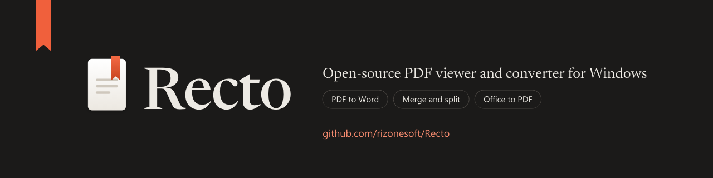

# Recto

Recto will be an open-source PDF viewer, OCR tool and document converter for Windows 11.
It is designed as a single native WinUI 3 application backed by Recto's own C++20 PDF engine (`recto-pdf`), built-in High-Accuracy Neural OCR + `Windows.Media.Ocr`, and 100% pure native C++20 document converters (`PDF <-> Word`, `Office & Legacy Office -> PDF`, `PDF <-> Images`, `PDF -> Text`, and page organization): read, search, OCR, convert and organize documents without accounts, telemetry by default, external converter requirements, or artificial limits.

**Status:** Early milestone M0 (repository and build scaffold). No application functionality is shipped yet; the repository holds the approved interface specification, the foundation architecture plan, the generated graphics, the C++20 module scaffold, and the live TODO execution plan that builds version 1 from M0 (repository and build) through M6 (Microsoft Store release).

## Planned for version 1

- **Read and navigate** (M1 to M3): continuous, single-page and two-page spread views rendered by Recto's native C++20 `recto-pdf` engine onto a Direct2D and `SwapChainPanel` surface; tabs in the title bar; outline and thumbnail panels; dark-theme page dimming; text selection, search (`Ctrl+F`), built-in High-Accuracy Neural OCR + `Windows.Media.Ocr` for scanned and vector-outlined pages (with deskew, morphological line removal, XY-cut/table layout segmentation, per-character CTC quad alignment, and searchable-PDF output), and a UI Automation text provider for screen readers.
- **One shell, three layout presets** (M2): Focus (floating toolbar and cards, the default), Classic (docked command bar and navigation rail) and Reading room (filmstrip and right inspector), all rearrangements of the same controls.
- **Convert** (M4 and M5): PDF to images (PNG, JPEG, TIFF, BMP), images to PDF, PDF to plain text, searchable OCR PDF, PDF to Word (`.docx`, `.rtf`) via Recto's native C++20 OpenXML/RTF writer, and Office documents (`.docx`, `.docm`, `.doc`, `.xlsx`, `.xlsm`, `.xls`, `.pptx`, `.pptm`, `.ppt`, `.rtf`, `.csv`, `.html`, `.md`) to PDF via Recto's 100% built-in C++20 OpenXML, legacy binary OLE2 (`[MS-CFB]`/`[MS-DOC]`/`[MS-XLS]`/`[MS-PPT]`), RTF, HTML and Markdown engines with zero external dependencies.
- **Organize** (M4): combine multiple PDFs, split by ranges or visual breaks, reorder, rotate, delete and extract pages, and add or remove AES-256 passwords and permissions, always on a copy and saved atomically.

## Governing documents

| Document | Role |
| -------- | ---- |
| [`docs/plans/2026-10-13-recto-foundation.md`](./docs/plans/2026-10-13-recto-foundation.md) | Decisions D1 to D17, module boundaries, the `recto-pdf` engine and threading contract, built-in OCR, native converters, milestones M0 to M6, performance targets, security rules. |
| [`design/SPEC.md`](./design/SPEC.md) | The interface source of truth: tokens, typography, layout presets, screens, dialogs, keyboard shortcuts and accessibility. |
| [`todo/TODO-00-INDEX.md`](./todo/TODO-00-INDEX.md) | The live execution plan across domains `00-workspace` to `07-release` and `99-manual`, projected into [`todo/implementation-plan.md`](./todo/implementation-plan.md). |
| [`resources/README.md`](./resources/README.md) | The shipped icons, wordmarks and MSIX package assets generated from the design tokens. |

## Building and verifying

The one-command native build (`.\build.cmd`) compiles `Recto.sln` (`recto-pdf`, `recto-core`, `recto-services`, `Recto`, `recto-cli`, `recto-tests`, `recto-fuzz`) for x64 and ARM64 in Debug and Release and runs the x64 test suite (see [`CONTRIBUTING.md`](./CONTRIBUTING.md) for prerequisites).
Validate the execution plan and its tooling with Python 3.11 or newer:

```powershell
python scripts/todo-graph.py validate
python scripts/todo-graph.py plan --check
python -m unittest tests.scripts.test_todo_graph
```

## Contributing

See [`CONTRIBUTING.md`](./CONTRIBUTING.md) for the workflow and [`CLA.md`](./CLA.md) for the contributor license agreement required before a pull request can be merged.

## License

Recto is free software licensed under the **GNU General Public License, version 3 or later** (`GPL-3.0-or-later`); see [`LICENSE`](./LICENSE) and [`NOTICE.md`](./NOTICE.md) for third-party notices.
